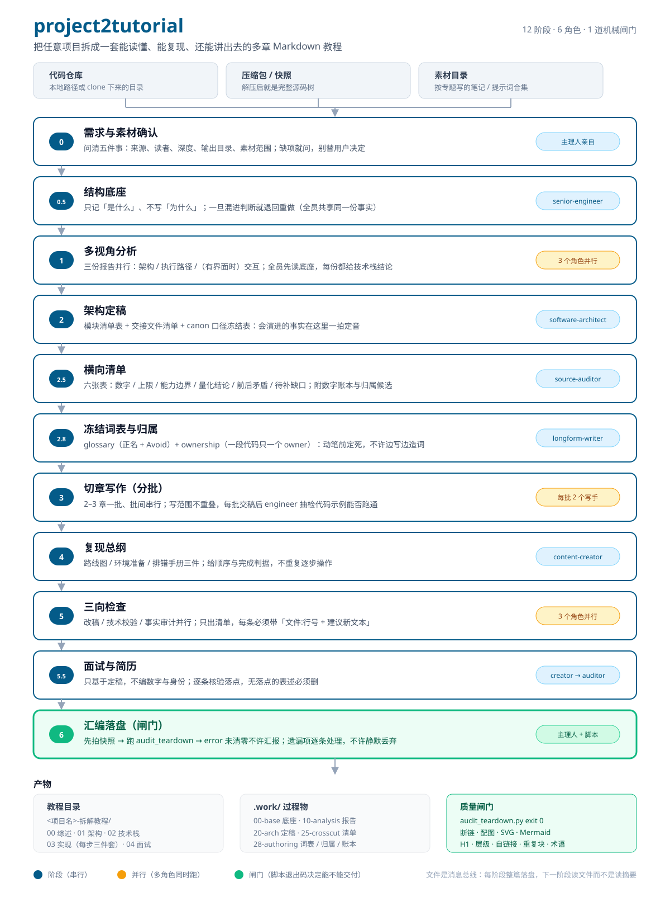

# project2tutorial

把任意项目拆成一套**能读懂、能复现、还能拿出去讲**的多章 Markdown 教程。

它是给 AI Agent（Claude Code、Cursor、DeepSeek Harness 等）用的 **skill**：你只负责编排一条由子 agent 组成的流水线，不亲手写章节、不亲手画架构图。输入是一个代码仓库 / 压缩包 / 一堆按专题写的笔记，输出是一棵按阅读顺序生长的教程目录树。



---

## 为什么值得用

三个问题决定了它必须这么组织：

**1. 先建底座，再分析。**
三个分析者各自摸索同一份代码库，必然得出互相矛盾的结论。真实案例里，同一项目并行分析后交叉核对撞出 7 处口径分歧，只能逐条回原文核实。所以第一步由 `senior-engineer` 产出一份**只记录「是什么」、不含任何判断**的事实底座，全员基于同一份开工——分歧的地基就没了。

**2. 文件是消息总线。**
一个阶段的完整正文必须落成文件，下一阶段拿到的是**文件路径 + 一句「整篇读完再开工」**。摘要一旦进了上下文，内容就丢了——这不是节约，是破坏。

**3. 三个检查方向不可合并。**
主笔管「写得清不清楚」，工程师管「跑不跑得通」，审计管「漏没漏、对不对得上」。只做前两项，教程会「看起来很完整但少了东西」，而少了什么事后很难发现。

还有一条是这次迭代新增的：**术语、归属、数字必须在动笔前冻结**。四十多篇的教程，一致性靠「写的人记性好」不成立——不冻结就会出现同一概念三四种叫法、同一份代码贴两遍、同一指标两个数字并存。

---

## 工作流（12 个阶段）

| Phase | 做什么 | 主要产出 | 谁来做 |
|---|---|---|---|
| **0** | 需求与素材确认：来源、读者、深度、输出目录、素材范围 | 五件事的答案 + Phase 序列 | 主理人 |
| **0.5** | 结构底座：只记事实，不含判断 | `.work/00-base/baseline.md` | senior-engineer |
| **1** | 多视角分析：架构 / 执行路径 /（有界面）交互，并行 | `.work/10-analysis/*.md` | architect + engineer (+ ui) |
| **2** | 架构定稿：模块清单表、交接文件清单、**canon 口径冻结表** | `.work/20-arch/final-architecture.md` | software-architect |
| **2.5** | 横向清单：六张表 + 数字账本 + 归属冲突候选 | `.work/25-crosscut/lists.md`、`28-authoring/numbers.md` | source-auditor |
| **2.8** | **冻结词表与唯一归属**：正名 + `_Avoid_`；一段代码只一个 owner | `.work/28-authoring/glossary.md`、`ownership.md` | longform-writer |
| **3** | 切章写作：2–3 章一批、批间串行；每批交稿后抽检代码示例 | 章节正文 + `assets/` | longform-writer + content-creator |
| **4** | 复现总纲：路线图 / 环境准备 / 排错手册 | `03-实现开始/00-复现总指引/` | content-creator |
| **5** | 三向检查：改稿 / 技术校验 / 事实审计，并行；只出清单 | `.work/50-review/*.md` | writer + engineer + auditor |
| **5.5** | 面试与简历：只基于定稿，逐条核落点 | `04-面试与简历/` | content-creator → source-auditor |
| **6** | 汇编落盘：拍快照 → 跑脚本 → **error 清零才许汇报** | 修正入稿 + `README.md` | 主理人 |

阶段之间的交接永远是「文件路径 + 整篇读完再开工」，不是摘要。

---

## 六个角色

| role id | 名字 | 职责 | 何时拉 |
|---|---|---|---|
| `software-architect` | 高见远 · 软件架构师 | 整体与模块运行架构、模块边界与契约、技术栈定稿、**口径冻结表** | 必拉 |
| `senior-engineer` | 寇豆码 · 高级开发工程师 | 结构底座、执行路径、数据流、构建机制、**每批写作后的代码示例抽检** | 必拉 |
| `longform-writer` | 沈炼文 · 长文档主笔 | 目录骨架、章节正文、**冻结词表与唯一归属**、编号与结构治理、配图引用 | 必拉 |
| `content-creator` | 顾灵犀 · 内容创作专家 | 教学表达、从零复现指引、面试与简历。**不得自造术语** | 必拉 |
| `source-auditor` | 查秋毫 · 事实核查与素材审计 | 横向清单、**数字账本**、覆盖率对账、事实与溯源核验 | 必拉 |
| `ui-designer` | 颜有度 · UI 设计师 | 界面结构、交互链路、界面配图与视觉规范 | **可选**：有界面，或全书图 ≥ 8 张需要统一视觉规范时 |

角色就是 `references/roles/<id>.md`；派工时把整篇交给子 agent，分工边界写死在文件里。

---

## 安装

Skill 目录约定是 `~/.agents/skills/<name>/SKILL.md`，本仓库的根目录就是 skill 根，直接 clone 进去即可：

```bash
# macOS / Linux
git clone https://github.com/Jenlybein/project2tutorial.git ~/.agents/skills/project2tutorial

# Windows PowerShell
git clone https://github.com/Jenlybein/project2tutorial.git "$env:USERPROFILE\.agents\skills\project2tutorial"
```

装好之后，Agent 在遇到「帮我拆解这个项目」「把这个仓库讲透」「这个项目面试该怎么讲」这类请求时会自动加载它。

---

## 怎么触发

对它说人话就行，例如：

- 「我本地有个项目 `D:\projects\mini-rag`，帮我拆解成一套能看懂、也能从零复现的多章教程」
- 「不用写教程，我只想搞明白这个仓库分几块、一次问答请求怎么从入口跑到向量库」
- 「我攒了 20 多篇按专题写的笔记，帮我整理成按实现步骤组织的教程，数字和上限别丢」
- 「教程写好了，帮我拆一下这东西面试该怎么讲、简历能怎么写」

技能内部按你手里的材料判档位：

| 档位 | 适用 | 路径 |
|---|---|---|
| **A** | 完整拆解 + 全教程（默认） | 0 → 0.5 → 1 → 2 → 2.5 → 2.8 → 3 → 4 → 5 → 5.5 → 6 |
| **B** | 只要架构，不写教程 | 0 → 0.5 → 1 → 2 → 6 |
| **C** | 已有架构，只要教程 | 2.5 → 2.8 → 3 → 4 → 5 → 6 |
| **D** | 只要章节文档（素材重组） | 0.5 → 2.5 → 2.8 → 3 → 5 → 6 |

---

## 质量闸门

交付前必须跑机械审计，**脚本有 error 就不许汇报**：

```bash
python scripts/audit_teardown.py "<教程目录>" \
  --glossary "<教程目录>/.work/28-authoring/glossary.md"

# 严格模式：README 必须直达每一个文件
python scripts/audit_teardown.py "<教程目录>" --readme-strict --json
```

它分两层检查：

| 层 | 查什么 |
|---|---|
| **文件系统层** | 断链、配图可达与归属目录、`alt` 是否说清内容、SVG 是否合法、全篇有无 Mermaid / 字符画 / 正文里的 SVG 源码、README 导航覆盖、孤立与空置配图目录 |
| **文本层**（专治「看起来完整」） | 唯一 H1、标题层级跳跃、附录倒置、编号式 H2、步骤编号断档、自链接、全角括号配对、单篇行数（600 提醒 / 900 硬上限）、跨文件重复代码块与表格、冻结词表 `_Avoid_` 命中、中文夹多余空格 |

常用参数：

```bash
--glossary PATH        冻结词表路径（给了才做术语检查）
--max-lines N          单篇行数建议上限，默认 600
--max-lines-hard N     单篇行数硬上限，默认 900
--readme-strict        README 必须直接链到每个文件
--no-readme-check      跳过 README 覆盖检查
--json                 机器可读输出
```

退出码：有 error 返回 1；warn 不改变退出码但需人眼判断。

---

## 七条底线

目录形态可以随项目改，这七条不行：

1. **技术栈落到三层**：专章讲透、每步章首标注、复现指引给可安装的版本矩阵。
2. **每一步都有可执行的验证点**：只给命令不给「看到什么算通过」，等于没给。
3. **导航与术语全书一致**：README 链到每一章；同一概念全书同名同写法。
4. **关键结论必须带溯源**：有源码写 `文件:行号`，素材重组写 `源素材文档#小节`；没有引用的关键结论按不可信处理。
5. **面试与简历材料必须「答得上、核得实」**：每条表述都要在定稿里有落点，被追问三层仍答得出。
6. **配图与正文同步，正文能独立成立**：结构图只能手写 SVG；禁用 Mermaid、禁用字符画、禁止 AI 生图代替结构图；图是文件引用，路径一错全图就白。
7. **术语与归属先冻结，单篇有体量上限**：动笔前产出 `glossary.md` 与 `ownership.md`；同一段代码不重贴；单篇 ≤ 600 行，600–900 行必须加「本章怎么读」，> 900 行拆文件。

---

## 仓库结构

```
project2tutorial/
├── SKILL.md                     # 技能主文件：角色表、流水线、执行机制、底线
├── README.md                    # 本文件
├── assets/
│   └── workflow.svg             # 工作流图（手写 SVG）
├── evals/
│   └── evals.json               # 四个场景的评测用例（只描述期望产出形态）
├── references/
│   ├── pipeline.md              # 每个 Phase 的输入、验收标准、交接规则
│   ├── output-spec.md           # 交付目录形态、页型边界、每步三件套骨架
│   ├── canon-and-glossary.md    # 口径冻结 / 术语表 / 唯一归属 / 数字账本 / 自检 12 条
│   ├── diagrams.md              # 图型选择、四类核心图的 SVG 画法、路径与 alt
│   ├── workflows.md             # 小项目怎么裁剪流水线
│   └── roles/
│       ├── software-architect.md
│       ├── senior-engineer.md
│       ├── longform-writer.md
│       ├── content-creator.md
│       ├── source-auditor.md
│       └── ui-designer.md
└── scripts/
    ├── audit_teardown.py        # 机械审计（文件系统层 + 文本层）
    └── scaffold_teardown.py     # 建目录骨架与 .work/
```

---

## 文件清单

| 路径 | 作用 |
|---|---|
| `SKILL.md` | 技能主文件：六角色表、12 阶段流水线、执行机制、七条底线、翻车对策 |
| `assets/workflow.svg` | 本文件顶部那张工作流图（手写 SVG，viewBox 自适应） |
| `evals/evals.json` | 四个场景的评测用例（只描述期望产出形态，断言在首轮跑完后补） |
| `references/pipeline.md` | 每个 Phase 的输入、验收标准、交接规则；文件即消息总线的约定 |
| `references/output-spec.md` | 交付目录形态、页型边界（每类文件不写什么）、每步三件套骨架 |
| `references/canon-and-glossary.md` | 口径冻结 / 术语表 / 唯一归属 / 数字账本 / 口径演进标注 / 结构自检 12 条 |
| `references/diagrams.md` | 图型选择、四类核心图的 SVG 画法、路径与 `alt`、配图归属 |
| `references/workflows.md` | 小项目、无界面、无源码时怎么裁剪流水线 |
| `references/roles/software-architect.md` | 架构视角分析 + 架构定稿 + canon 口径冻结表 |
| `references/roles/senior-engineer.md` | 结构底座 + 执行路径 + 代码示例可执行性抽检 |
| `references/roles/longform-writer.md` | 目录骨架 + 章节正文 + 冻结词表与唯一归属 + 结构治理 |
| `references/roles/content-creator.md` | 教学表达 + 复现总纲 + 面试与简历（不得自造术语） |
| `references/roles/source-auditor.md` | 横向清单 + 数字账本 + 覆盖率与事实核验 |
| `references/roles/ui-designer.md` | 界面结构与交互链路 + 视觉规范（可选角色） |
| `scripts/audit_teardown.py` | 机械审计：文件系统层 + 文本层，退出码即交付闸门 |
| `scripts/scaffold_teardown.py` | 建教程目录骨架与 `.work/` 子目录 |

## 它不创造事实

代码里读不出来的设计意图，只能标「推测 + 依据」，不能写成结论；命令没在干净环境验证过，就标「需验证」。

用户会拿这套教程去复现、去投简历——写错的代价由他承担。所以宁可写「未定位」，不要写看起来很懂的猜测。
