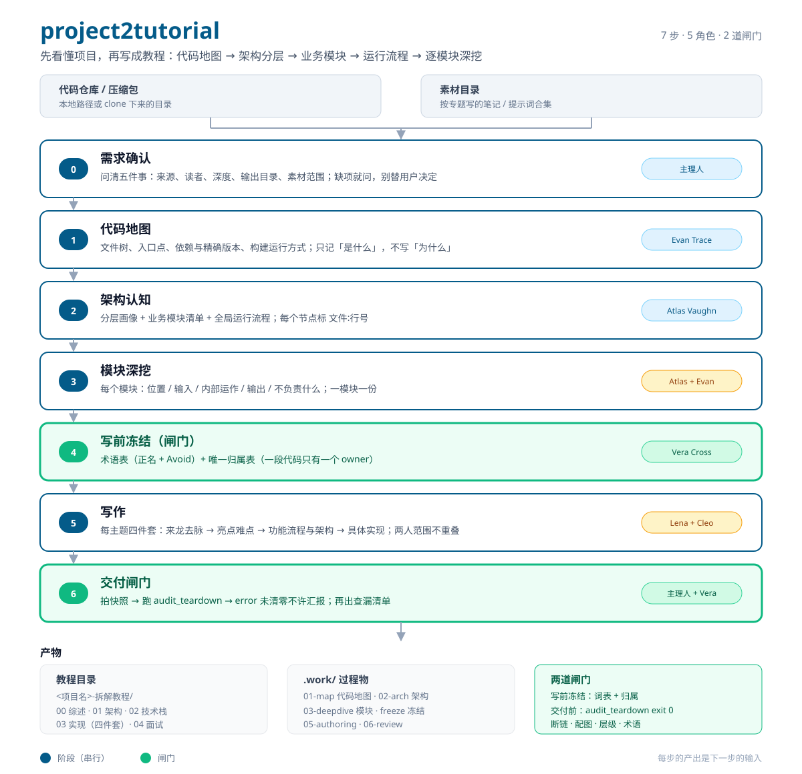

# project2tutorial

把任意项目拆成一套**能读懂、能复现、还能拿出去讲**的多章 Markdown 教程。

它是给 AI Agent（Claude Code、Cursor、DeepSeek Harness 等）用的 **skill**：你只负责编排一条由子 agent 组成的流水线，不亲手写章节、不亲手画架构图。输入是一个代码仓库 / 压缩包 / 一堆按专题写的笔记，输出是一棵按阅读顺序生长的教程目录树。



---

## 安装

### 方式一：skills CLI（推荐）

```bash
npx skills add https://github.com/Jenlybein/project2tutorial --skill project2tutorial
```

- 默认装到**当前项目**，CLI 会自动识别并写入 `.agents/skills/`、`.claude/skills/` 等目录，并生成 `skills-lock.json`
- 加 `--global` 装到用户级；加 `--agent '*'` 装到本机所有支持的 agent
- 只想看看仓库里有什么：`npx skills add https://github.com/Jenlybein/project2tutorial -l`

### 方式二：手动 clone

```bash
# macOS / Linux
git clone https://github.com/Jenlybein/project2tutorial.git ~/.agents/skills/project2tutorial

# Windows PowerShell
git clone https://github.com/Jenlybein/project2tutorial.git "$env:USERPROFILE\.agents\skills\project2tutorial"
```

装好之后，遇到「帮我拆解这个项目」「把这个仓库讲透」「这个项目面试该怎么讲」这类请求，Agent 会自动加载它。

---

## 它怎么工作

**一条路，七步，每步的产出是下一步的输入：**

| 阶段 | 谁 | 做什么 |
|---|---|---|
| 0 需求确认 | 主理人 | 问清来源、读者、深度、输出目录、素材范围 |
| 1 代码地图 | Evan Trace | 文件树、入口、依赖、构建与运行方式 |
| 2 架构认知 | Atlas Vaughn | 分层画像 + 业务模块清单 + 全局运行流程 |
| 3 模块深挖 | Atlas Vaughn（Evan Trace 补路径） | 每个模块：分层画像 + **输入 → 内部运作 → 输出** |
| 4 写前冻结 | Vera Cross | 术语表 + 唯一归属表 |
| 5 写作 | Lena Quill + Cleo Spark | 并行业写，写范围不重叠 |
| 6 交付闸门 | 主理人 + Vera Cross | 跑脚本 + 查漏清单 |

**为什么要先认知再动笔**：不懂结构就写章节，写出来的是猜测。代码地图 → 分层 → 模块 → 流程这四步，每步都在给下一步收窄范围；跳过任何一步，后面都要靠猜补。

**为什么要有两道闸门**：其余检查都砍了，只留对应「真会返工」的两处——写前冻结术语与归属（否则同一概念全书三四种叫法、同一段代码贴两遍），交付前跑一次脚本（否则断链、图挂掉、README 漏链没人发现）。

---

## 交付物长什么样

```
<项目名>-拆解教程/
├── README.md
├── 00-项目综述/          项目立意 · 项目亮点
├── 01-整体架构/          架构总览 · 目录结构 · 具体模块 · 设计决策 · 其他补充
├── 02-技术栈/            选择与决策 · 环境安装
├── 03-具体实现/
│   ├── 00-项目准备/      外部服务 · 搭建骨架
│   ├── 01-<能力主题>/    来龙去脉 · 亮点难点 · 功能流程与架构 · 具体实现
│   └── NN-<能力主题>/
├── 04-面试与简历/        项目陈述 · 简历写法 · 面试问答
└── assets/               配图，按章节同名子目录
```

每个实现主题四篇，各只回答一个问题：**为什么走到这一步** → **难在哪值在哪** → **做了什么怎么流转** → **怎么动手怎么验证**。

---

## 五个角色

| 角色 | 名字 | 负责 |
|---|---|---|
| `software-architect` | Atlas Vaughn | 架构分层、模块识别、逐模块深挖、整体架构篇 |
| `senior-engineer` | Evan Trace | 代码地图、运行流程、代码路径、可执行性 |
| `longform-writer` | Lena Quill | 目录骨架、章节正文、配图引用 |
| `content-creator` | Cleo Spark | 项目综述、来龙去脉、具体实现、面试与简历 |
| `source-auditor` | Vera Cross | 写前冻结、交付前查漏 |

单点直调也支持：只想问「分几层」「这段代码怎么跑」「面试怎么讲」，直接调对应角色，不走全流程。

---

## 质量闸门

交付前必须跑机械审计，**脚本有 error 就不许汇报**：

```bash
python scripts/audit_teardown.py "<教程目录>" --glossary "<教程目录>/.work/freeze/glossary.md"
```

| 层 | 查什么 |
|---|---|
| 文件系统层 | 断链、配图可达与图目录归属、`alt`、SVG 合法性、Mermaid / 字符画 / 正文图源码、README 导航覆盖 |
| 文本层 | 唯一 H1、标题层级跳跃、附录倒置、自链接、单篇行数（600 提醒 / 900 硬上限）、跨文件重复代码块与表格、术语避用词、中文夹多余空格 |

常用参数：

```
--glossary PATH        冻结词表路径（给了才做术语检查）
--max-lines N          单篇建议上限，默认 600
--max-lines-hard N     单篇硬上限，默认 900
--readme-strict        README 必须直接链到每个文件
--profile skill        审计 skill 说明仓库自身时用
--json                 机器可读输出
```

退出码：有 error 返回 1；warn 不改变退出码但需人眼判断。

---

## 仓库结构

```
project2tutorial/
├── SKILL.md                       主文件：五角色、七阶段、两道闸门
├── assets/workflow.svg            流水线图（手写 SVG）
├── evals/evals.json               评测用例
├── references/
│   ├── pipeline.md                每个阶段的输入 → 内部运作 → 输出
│   ├── output-spec.md             目录形态、四件套分工、叙述链、语言尺度
│   ├── glossary-and-ownership.md  写前冻结：术语表与唯一归属
│   ├── diagrams.md                图型选择、SVG 画法、路径与 alt
│   └── roles/                     五份角色作业说明
└── scripts/
    ├── audit_teardown.py          机械审计，退出码即闸门
    └── scaffold_teardown.py       建目录骨架与 .work/
```

## 它不创造事实

代码里读不出来的设计意图，只能标「推测 + 依据」，不能写成结论；命令没在干净环境验证过，就标「需验证」。

用户会拿这套教程去复现、去投简历——写错的代价由他承担。所以宁可写「未定位」，不要写看起来很懂的猜测。

## License

MIT，见 [LICENSE](LICENSE)。
